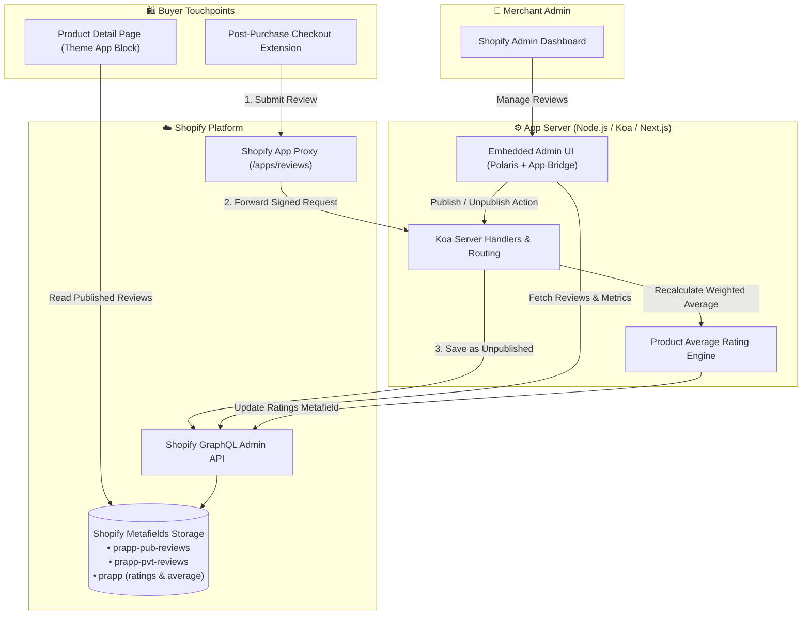

# 🌟 Shopify Product Reviews Sample App

<p align="center">
  
</p>

<p align="center">
  <a href="https://shopify.dev/docs/apps"></a>
  <a href="https://nextjs.org/"></a>
  <a href="https://polaris.shopify.com/"></a>
  <a href="https://graphql.org/"></a>
  <a href="https://nodejs.org/"></a>
  <a href="LICENSE.md"></a>
</p>

---

## 📌 Overview

The **Shopify Product Reviews Sample App** is a full-featured reference implementation showcasing how modern Shopify developer tooling, APIs, and extension points integrate into an end-to-end merchant and buyer experience.

Instead of requiring external databases, this application utilizes **Shopify Metafields** as a serverless data layer to store review records, moderate customer submissions, and compute dynamic star rating metrics directly within Shopify.

### 🧩 Core Pillars

| Component | Technology | Description |
| :--- | :--- | :--- |
| **Admin Application** | Next.js, Koa, Polaris, App Bridge | Embedded merchant portal for moderating, filtering, and publishing reviews with product rating breakdowns. |
| **Storefront App Block** | Theme App Extensions (Liquid, CSS, JS) | Online Store 2.0 drag-and-drop theme blocks displaying star badges and customer feedback without touching theme code. |
| **Post-Purchase Extension**| Checkout Post-Purchase UI Extension | High-intent review capture prompt displayed immediately after order confirmation. |
| **Serverless Data Engine** | Shopify GraphQL Admin API (Metafields) | Persistent data storage for reviews, moderation status, and weighted average ratings. |

> [!NOTE]  
> This repository is an educational sample app. While it provides full end-to-end functionality, production applications should adopt Shopify's latest CLI and App template conventions ([shopify-app-template-node](https://github.com/Shopify/shopify-app-template-node)).

---

## 🚀 Key Features

- **⭐ Zero-Code Theme Integration:** App Blocks allow merchants to add, reorder, and style product reviews directly in the Shopify Theme Customizer.
- **🛍️ Post-Purchase Review Capture:** Converts recent buyers into reviewers directly on the post-purchase checkout page.
- **🛡️ Merchant Moderation Suite:** Polaris-powered admin UI to approve, publish, unpublish, or delete submitted reviews.
- **⚡ Dynamic Rating Calculation:** Automatic calculation of weighted average star ratings (1–5 stars) stored directly in Product Metafields.
- **🔐 Secure App Proxy:** Authenticated storefront-to-backend communication via HMAC-verified Shopify App Proxy.
- **📦 Serverless Metafield Storage:** No external SQL/NoSQL databases required for review persistence.

---

## 🏗️ Architecture & Data Flow



---

## 📁 Repository Structure

```text
product-reviews-sample-app/
├── checkout-extension/         # Post-purchase checkout UI extension
│   └── src/                    # Review submission UI shown after order confirmation
├── theme-app-extension/        # Online Store 2.0 Theme App Extension
│   ├── blocks/                 # Liquid app blocks (star ratings & review form)
│   ├── snippets/               # Reusable Liquid components
│   └── assets/                 # Extension-specific styles and client JS
├── pages/                      # Next.js frontend pages (embedded admin)
│   ├── index.js                # Initial router & onboarding redirect
│   ├── getting-started.js      # In-app setup & verification guide
│   └── products/               # Product review moderation dashboard & details
├── server/                     # Koa backend server
│   ├── handlers/               # App Proxy handlers, webhooks, and routing
│   ├── jobs/                   # Background tasks & rating calculations
│   └── server.js               # Koa initialization, OAuth, and Next.js bridge
├── components/                 # Polaris UI components for the merchant admin
├── graphql/                    # GraphQL queries & mutations for Admin API
├── docs/                       # In-depth setup tutorials and technical specs
│   ├── technical-details/      # Architectural deep-dives (Metafields, Auth, etc.)
│   ├── getting-started.md      # Detailed installation guide
│   ├── theme-app-extension.md  # Theme extension tutorial
│   └── checkout-extension-post-purchase.md
└── package.json                # Project dependencies and npm scripts
```

---

## ⚡ Quickstart Guide

Follow these steps to get the embedded app and extensions running locally.

### 1. Prerequisites

- **Node.js**: Version `14.x` or `16.x` (*Node 17+ has known OpenSSL legacy compatibility issues*).
- **Shopify CLI**: Install the Shopify CLI ([Installation Guide](https://shopify.dev/docs/apps/tools/cli)).
- **Partner Account**: Active [Shopify Partners account](https://partners.shopify.com/signup).
- **Development Store**: A development store with "Developer Preview" or "Online Store 2.0" enabled.
- **Tunnel Tool**: [ngrok](https://ngrok.com/) or Cloudflare Tunnel to expose local ports.

---

### 2. Installation & Setup

1. **Clone the repository:**
   ```bash
   git clone https://github.com/srinathdoggala-tech/shopify-review-ai.git
   cd shopify-review-ai
   ```

2. **Install project dependencies:**
   ```bash
   npm install
   ```

3. **Install extension dependencies:**
   ```bash
   cd checkout-extension && npm install && cd ..
   ```

---

### 3. Register the App in Shopify Partner Dashboard

1. Navigate to your [Shopify Partner Dashboard](https://partners.shopify.com/) > **Apps** > **Create App**.
2. Select **Public App** and give it a name (e.g., *Product Reviews App*).
3. Set temporary URLs (these will update via Shopify CLI):
   - **App URL**: `https://localhost:3000/`
   - **Allowed redirection URL(s)**: `https://localhost:3000/auth/callback`

---

### 4. Connect with Shopify CLI & Environment Configuration

1. Log into your Shopify Partner organization:
   ```bash
   shopify login
   ```

2. Connect your local workspace to the newly registered app:
   ```bash
   shopify app connect
   ```
   *Select your organization, the app you just created, and your development store.*

3. Copy the sample environment file if not already created:
   ```bash
   cp .env-sample .env
   ```

4. Populate your `.env` configuration:

| Variable | Description |
| :--- | :--- |
| `SHOPIFY_API_KEY` | App API Key from Partner Dashboard. |
| `SHOPIFY_API_SECRET` | App API Secret from Partner Dashboard. |
| `SHOP` | Your development store domain (e.g. `your-store.myshopify.com`). |
| `SCOPES` | `write_products,write_customers,write_draft_orders,read_themes` |
| `HOST` | Active public HTTPS URL (e.g. `https://your-tunnel.ngrok.io`). |
| `THEME_APP_EXTENSION_UUID` | Generated extension UUID after deploying the theme extension. |

---

### 5. Configure App Proxy

To allow the storefront and post-purchase extension to securely submit reviews:

1. Open your app in the **Shopify Partner Dashboard**.
2. Navigate to **App setup** > **App Proxy**.
3. Set the following configuration:
   - **Subpath prefix**: `apps`
   - **Subpath**: `reviews`
   - **Proxy URL**: `https://<YOUR_TUNNEL_URL>/proxy`
4. Click **Save**.

---

### 6. Run the Application

Start the local Koa and Next.js development server:

```bash
npm run dev
```

Visit your tunnel URL or access the app from your Shopify Partner Dashboard to initiate OAuth and install the app onto your development store.

---

### 7. Preview Extensions

#### Theme App Extension
```bash
cd theme-app-extension
shopify extension serve
```
Open your theme customizer, click **Add Section** or **Add Block**, and add the **Product Reviews** and **Star Rating** blocks.

#### Post-Purchase Checkout Extension
```bash
cd checkout-extension
shopify extension serve
```

---

## 🗄️ Metafield Data Schema

Reviews and metrics are stored natively on individual Shopify `Product` resources:

```
Product
 ├── prapp-pub-reviews (Namespace)   -> Published reviews visible on storefront
 ├── prapp-pvt-reviews (Namespace)   -> Pending / Unpublished reviews awaiting moderation
 └── prapp (Namespace)
      ├── ratings                    -> Breakdown of 1 to 5 star count distribution
      └── avg_rating                 -> Weighted arithmetic mean rating (Float)
```

<details>
<summary><b>View Review JSON Object Structure</b></summary>

```json
{
  "id": "c1a2b3c4-d5e6-7890",
  "rating": 5,
  "title": "Outstanding quality!",
  "body": "Exceeded my expectations. Will definitely purchase again.",
  "name": "Jane Doe",
  "email": "jane.doe@example.com",
  "created_at": "2026-10-15T10:00:00.000Z",
  "state": "published"
}
```
</details>

<details>
<summary><b>View Ratings Weight Tally Structure</b></summary>

```json
{
  "1": { "weight": 1, "total": 2 },
  "2": { "weight": 2, "total": 1 },
  "3": { "weight": 3, "total": 4 },
  "4": { "weight": 4, "total": 15 },
  "5": { "weight": 5, "total": 48 }
}
```
</details>

---

## 📚 Deep-Dive Documentation

For exhaustive step-by-step guides and implementation details, explore the dedicated documentation suite:

- 📖 **Tutorials & Getting Started:**
  - [Installing the Embedded App](docs/getting-started.md)
  - [Configuring the Theme App Extension](docs/theme-app-extension.md)
  - [Setting up Checkout Post-Purchase Extensions](docs/checkout-extension-post-purchase.md)
- 💻 **Technical Deep Dives:**
  - [Authentication & Session Tokens](docs/technical-details/authentication.md)
  - [Metafield Data Layer Architecture](docs/technical-details/data-layer.md)
  - [Review Creation & Submission Pipeline](docs/technical-details/review-creation.md)
  - [Product Average Rating Algorithm](docs/technical-details/product-average-rating-calc.md)
  - [Publishing & Moderation Mechanics](docs/technical-details/publishing-reviews.md)

---

## 🛠️ Troubleshooting & FAQ

<details>
<summary><b>Node.js Version Incompatibility (Error: digital envelope routines::unsupported)</b></summary>

Node.js v17+ enables OpenSSL 3.0 by default, which causes crypto errors in Webpack 4/5 setups. Use Node `16.x` (`nvm use 16`) or start the app with:
```bash
NODE_OPTIONS="--openssl-legacy-provider" npm run dev
```
</details>

<details>
<summary><b>App Proxy returning 404 or Signature Mismatch</b></summary>

Ensure your App Proxy subpath is configured as `apps/reviews` with the destination pointing to `https://<YOUR_TUNNEL>/proxy`. Make sure your `.env` contains the exact `SHOPIFY_API_SECRET` matching your Partner Dashboard.
</details>

<details>
<summary><b>Theme Blocks not visible in Theme Editor</b></summary>

Ensure your theme supports Online Store 2.0 (JSON templates like `product.json`). If using a vintage Liquid theme, App Blocks cannot be placed directly without upgrading template files.
</details>

---

## 🤝 Contributing

Contributions, issues, and feature suggestions are welcome!
1. Fork the Project
2. Create your Feature Branch (`git checkout -b feature/AmazingFeature`)
3. Commit your Changes (`git commit -m 'Add some AmazingFeature'`)
4. Push to the Branch (`git push origin feature/AmazingFeature`)
5. Open a Pull Request

Please refer to the [Contributing Guide](CONTRIBUTING.md) and [Code of Conduct](CODE_OF_CONDUCT.md).

---

## 📄 License

Distributed under the MIT License. See [LICENSE.md](LICENSE.md) for more details.
